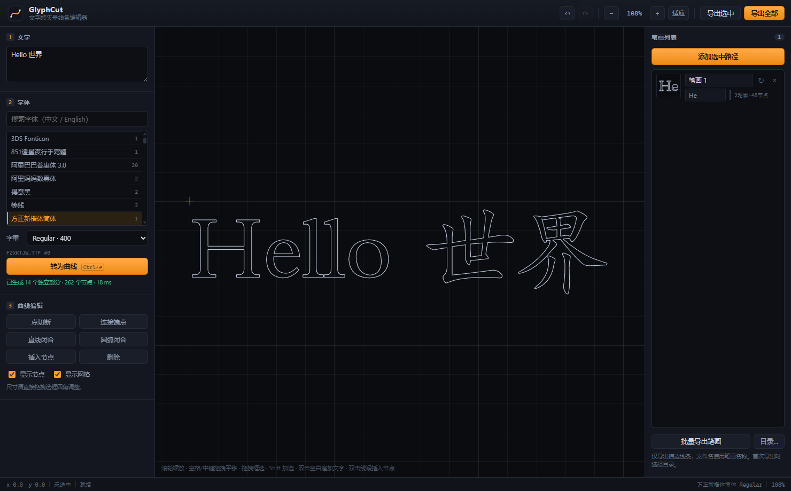

# GlyphCut · 文字转矢量线条编辑器

Tauri 2 + Rust 后端 + 原生 Canvas 前端的 Windows 桌面应用：**输入文字 → 选择系统字体 → 轮廓化为矢量路径 → 逐段编辑（移动/切断/连接/闭合/插入/删除）→ 加入笔画库（命名 + 例字）→ 批量导出 SVG**。

设计要点：文字转为矢量后，**每个轮廓都是一个可独立选中的对象**（例如「小」拆成 3 段）；尺寸不通过参数面板调节，而是直接拖拽选框四角缩放；导出统一为描边线条。默认字体优先「方正新楷体简体」，未安装时自动回退到「楷体」。

交互范式参考了 `JDSoft ArtForm 4.0` 的文字转曲线工作流（参考录屏抽帧见 `docs/reference/ref-*.jpg`）：左侧「文字 + 字体设置 + 曲线编辑」导航栏、中间黑色画布、右侧笔画列表、底部坐标状态栏。

```text
┌────────────────────┬──────────────────────────────┬────────────────────┐
│ 1 文字              │                              │ 笔画列表       [n] │
│ 2 字体 / 字重        │           画布                │  [+ 添加选中路径]   │
│ 3 曲线编辑           │   滚轮缩放 · 空格/中键平移      │  ┌──────┐ 名称  ↻ ×│
│   点切断 / 连接      │   拖拽框选 · Shift 加选        │  │ 缩略 │ 例字     │
│   直线/圆弧闭合      │                              │  └──────┘ 闭合·N节点│
├────────────────────┴──────────────────────────────┴────────────────────┤
│ x/y 坐标   选中状态   提示                         字体   缩放          │
└───────────────────────────────────────────────────────────────────────┘
```

当前界面（默认字体「方正新楷体简体」，「Hello 世界」14 个独立部分 / 262 节点）：



旧版 UI 截图已归档到 `docs/reference/legacy/`，仅用于对比历史版本，不代表当前界面。

---

## 1. 快速开始

```bash
cd text-vector-editor

# 方式 A：Tauri CLI（推荐，需联网装一次 npm 依赖）
npm install
npm test                  # 前端算法/编辑链路测试
npm run tauri dev         # 开发
npm run tauri build       # 打包 NSIS 安装包

# 方式 B：只用 Cargo（前端为纯静态资源，无需打包步骤）
cd src-tauri
cargo run                  # 调试运行
cargo test                 # 后端单元测试
cargo build --release      # 生成 target/release/glyphcut.exe
```

一键打包到桌面：双击 `package-to-desktop.cmd`（会先关闭正在运行的 GlyphCut，再编译 release 并复制到 `%USERPROFILE%\Desktop\GlyphCut.exe`）。

前置条件：Windows 10/11、WebView2 Runtime（系统自带）、Rust 1.77+、Node 18+（仅方式 A 需要）。

前端不引入任何 CDN 资源，`src/` 下全部为本地文件，也没有构建步骤——Tauri 直接以 `frontendDist: "../src"` 加载。

---

## 2. 目录结构与文件职责

```
text-vector-editor/
├─ .gitignore                     忽略 target / node_modules / 构建产物
├─ package.json                   仅含 @tauri-apps/cli，前端零构建
├─ package-to-desktop.cmd         一键 release + 复制到桌面
├─ README.md
├─ CHANGELOG.md                    本次修复记录
├─ src/
│  ├─ index.html                  应用骨架与全部静态 DOM 结构
│  ├─ styles.css                  深色 CAD 风格主题（纯 CSS 变量，无框架）
│  └─ js/
│     ├─ main.js                  入口：装配画布 + UI，暴露 __gc 调试钩子
│     ├─ api.js                   Tauri invoke 封装；非 Tauri 环境降级为 mock 数据
│     ├─ state.js                 全局状态、选择集、撤销/重做栈（快照式，60 步）
│     ├─ geometry.js              纯几何层：path d、bbox、采样、命中测试、切断/连接/插入/删除原语
│     ├─ edits.js                 文档级编辑操作（选择、切断、连接、闭合、插入、删除、笔画库）
│     ├─ canvas.js                Canvas 渲染 + 鼠标交互（缩放/平移/框选/拖拽/控制柄/整体缩放）
│     ├─ export.js                SVG 生成、XML 转义、原生保存对话框调用
│     └─ ui.js                    面板装配：字体列表、转换流程、笔画面板、快捷键
├─ tests/
│  └─ algorithms.test.mjs         前端算法与编辑链路测试（纯 Node）
├─ docs/reference/
│  ├─ app-verified.png            当前版本界面截图
│  ├─ ref-*.jpg                   ArtForm 交互参考帧
│  └─ legacy/                     旧版 UI 截图留档（非当前界面）
├─ tools/
│  └─ capture-cdp.mjs             可选的 WebView2 CDP 截图辅助脚本
└─ src-tauri/
   ├─ Cargo.toml                  依赖清单
   ├─ build.rs                    tauri-build
   ├─ tauri.conf.json             窗口/打包/安全策略（withGlobalTauri = true）
   ├─ capabilities/default.json   权限：dialog + system-fonts + 窗口控制（无 fs scope）
   ├─ icons/                      应用图标（已提交，打包直接使用）
   └─ src/
      ├─ main.rs                   桌面入口（release 不弹控制台）
      ├─ lib.rs                    插件注册 + 命令注册
      ├─ geom.rs                   Pt / Node / BBox 与三次贝塞尔求值
      ├─ fonts.rs                  fontdb 系统字体枚举（含 .ttc 面索引）
      ├─ outline.rs                ttf-parser 字形轮廓化 + 文字排版度量
      └─ save.rs                   原生保存对话框 + 文件写入 + 文件名净化
```

---

## 3. 依赖清单与版本

### Rust（`src-tauri/Cargo.toml`，Cargo.lock 已锁定）

| crate | 版本 | 用途 |
|---|---|---|
| `tauri` | 2.12.5 | 桌面运行时、IPC、窗口 |
| `tauri-build` | 2.7.4 | 构建脚本 |
| `tauri-plugin-dialog` | 2.8.3 | 原生「另存为」/文件夹选择 |
| `tauri-plugin-system-fonts` | 2.0.2 | 系统字体列表（兜底通道） |
| `fontdb` | 0.23 | 系统字体枚举 + 面索引 |
| `ttf-parser` | 0.25.1 | 字形 outline 解析 |
| `serde` / `serde_json` | 1.x | 命令参数与返回值序列化 |

> `tauri-plugin-dialog` 在依赖树中会带入 `tauri-plugin-fs`，但本项目**没有注册 fs 插件、也没有授予任何 fs scope**；写盘只走 Rust 命令。

### npm（`package.json`）

| 包 | 版本 | 用途 |
|---|---|---|
| `@tauri-apps/cli` | ^2.12.4 | `tauri dev` / `tauri build` |

前端通过 `withGlobalTauri: true` 直接使用全局 `window.__TAURI__`，不依赖 `@tauri-apps/api` 打包。

---

## 4. 权限配置（`src-tauri/capabilities/default.json`）

```json
{
  "identifier": "default",
  "windows": ["main"],
  "permissions": [
    "core:default",
    "core:window:allow-start-dragging",
    "core:window:allow-minimize",
    "core:window:allow-toggle-maximize",
    "core:window:allow-close",

    "dialog:default",
    "dialog:allow-save",
    "dialog:allow-message",
    "dialog:allow-ask",

    "system-fonts:default",
    "system-fonts:allow-get-system-fonts"
  ]
}
```

`dialog:default` 已包含 `allow-open`（文件夹选择）与 `allow-save`。没有 fs 权限；SVG 写入由 `save.rs` 命令执行，前端无法直接调用任意文件 API。

---

## 5. 关键实现说明

### 5.1 系统字体枚举与字体文件路径

`tauri-plugin-system-fonts`（基于 fontdb）已注册为兜底通道，但它有一个关键缺口：**返回值不含字体集合内的面索引**。Windows 上大量中文字体是 `.ttc` 集合（`msyh.ttc` 含 Regular/Bold/Light 等多个面，`simsun.ttc` 含宋体/新宋体），缺少 `index` 时 `ttf-parser` 只能解析第 0 个面——用户选「微软雅黑 Bold」实际拿到的仍是 Regular。

因此 `fonts.rs` 直接用 fontdb 自行枚举，额外输出 `index`：

```rust
let mut db = fontdb::Database::new();
db.load_system_fonts();
for face in db.faces() {
    let path = match &face.source { fontdb::Source::File(p) => ..., _ => continue };
    // families: Vec<(String, Language)> —— 优先取中文族名；familyEn 优先取 ASCII 名
    // face.index → .ttc 面索引；face.weight.0 → 字重；face.style → Normal/Italic/Oblique
}
```

返回值 `FontEntry { family, familyEn, subfamily, path, index, weight, style, monospaced }`，按族名排序后缓存在 `OnceLock<Mutex<...>>` 中，`list_fonts(force)` 支持刷新。

前端 `ui.js` 先调 `list_fonts`，失败则回退 `invoke('plugin:system-fonts|get_system_fonts')` 并映射为同一结构（`index` 退化为序号）。字体列表按族聚合 → 族下拉 + 「字重」子下拉（列出该族全部面），并支持中英文双向搜索。

### 5.2 文字轮廓化

**选型**：`ttf-parser` 直接解析 `glyf` / `CFF` outline。`text2svg` 更偏向「整段文字一次性渲染成 SVG」，不暴露逐字符节点，无法满足「每个字符独立选中、节点级编辑」的需求，故未采用。

**流程**（`outline.rs`）：

1. `Face::parse(&data, face_index)`，字体字节流按路径缓存在 `OnceLock<Mutex<HashMap<String, Arc<Vec<u8>>>>>`，避免每次转换重读几十 MB 的 `.ttc`。
2. `face.glyph_index(ch)` 取字形；`face.outline_glyph(gid, &mut Collector)` 收集 `move_to / line_to / quad_to / curve_to / close` 事件流。
3. 事件流 → 节点结构：
   - `Line` → 新节点，无控制柄；
   - `Quad(q, p)` 升阶为三次：`c1 = p0 + 2/3(q-p0)`、`c2 = p2 + 2/3(q-p2)`；
   - `Cubic(a,b,p)` → 上一节点 `out = a`，新节点 `in = b`；
   - `Close` → 标记闭合；若末点与首点重合则合并节点，并把闭合段的入控制柄移交首节点。
4. 坐标变换（字体 y 轴向上 → 设计坐标 y 轴向下）：
   `x' = offsetX + (x + y·tan(slant))·sx`，`y' = baselineY − y·sy`，
   其中 `sy = size/unitsPerEm`、`sx = sy · widthScale`。倾斜用切变实现，保证斜体与字宽互不干扰。
5. 排版：逐字 `glyph_hor_advance·sx + letterSpacing` 累加推进，并叠加 `kern` 表字偶距；多行按 `baselineY = ascent + lineIndex · lineHeight`。

**输出结构**（每字符一条 `Shape`，可独立选中）：

```jsonc
{
  "ch": "世", "line": 0, "charIndex": 6,
  "contours": [
    { "closed": true,
      "nodes": [ { "x": 12.3, "y": 88.1, "in": {"x":..,"y":..}, "out": {"x":..,"y":..} } ]
    }
  ],
  "bbox": { "x":.., "y":.., "w":.., "h":.. },
  "advance": 160.0
}
```

**分批与性能**：`measure_text` 先算各行宽度/升部；`outline_text` 按**行**调用，单行超过 200 字符再切块，每块之间 `await requestAnimationFrame()` 让出主线程，因此 >500 字符也不会卡死 UI。实测「Hello 世界」Rust 侧耗时 3~8 ms，整个转换（含 IPC + 首帧渲染）< 60 ms。

### 5.3 前端数据结构与切断/连接算法

```js
Shape   { id, ch, contours: [Contour], bbox, advance, visible }
Contour { nodes: [Node], closed: boolean }
Node    { x, y, in: {x,y}|null, out: {x,y}|null }   // in/out 为绝对坐标控制柄
Stroke  { id, name, example, contours: [Contour] }  // 一个笔画可含多条轮廓
```

**选中粒度**：Rust 返回的每个字符包含多个轮廓（「小」= 3 个闭合轮廓），前端在 `ui.js` 的 `emitLine()` 里**按轮廓拆成多个独立路径对象**，因此每个独立部分都能单独点选。

**笔画库合并**：点「添加选中路径」时，本次选中的所有闭合轮廓会合并成**一个 `Stroke`**（`contours` 数组），而不是一个路径一个笔画；例字取这些路径 `ch` 的去重集合。缩略图、节点统计、`↻` 更新和批量导出都按整组轮廓处理。代价是拖动整个字需要框选，而不是点一下字符。

统一用三次贝塞尔表示，直线段即 `in/out` 为 `null`。`contourToPathData()` 在任一控制柄存在时输出 `C`，否则输出 `L`；闭合轮廓补最后一段并 `Z`。

**切断** `splitContourAt(contour, ni)`：

- 闭合轮廓：以 `ni` 为起点旋转节点序列，首节点丢弃 `in`、末尾追加一个同坐标副本并丢弃其 `out` → **一条开放轮廓**（节点数 +1，几何不变）。这正是「在闭合环上切一刀变成开口线」的语义。
- 开放轮廓：在 `ni` 处拆成 `[0..ni]` 与 `[ni..n-1]` 两条，接缝处分别清空 `out` / `in` → **两条开放轮廓**。
- 端点处调用返回 `null`（已是端点，无需切断）。

点切断工具 `cutAt()` 会在**轮廓副本**上先插入节点再切断，成功后才写入文档并 `pushHistory()`；在端点处误点不会产生空的撤销步。

**连接** `joinContours(A, whichA, B, whichB)`：

1. 定向：把 A 的选中端点摆到**末尾**（选中的是 `start` 就把 A 整体反向），把 B 的选中端点摆到**开头**；
2. 清空接缝处 `out` / `in`；
3. 两端点距离 < 0.01 时合并为一个节点，否则保留两节点并用直线相连；
4. 同一轮廓的两个端点连接 → `closed = true`（走 `closeContour`，首尾重合时合并）。

**插入节点**用 de Casteljau 精确分割：直线段取线性插值点；曲线段求 `p01/p12/p23 → p012/p123 → p`，把 `a.out` 改成 `p01`、`b.in` 改成 `p23`、新节点带 `in=p012 / out=p123`，**形状完全不变**（测试逐点校验偏差 < 1e-9）。

**闭合**提供「直线闭合」与「圆弧闭合」两种：圆弧模式在接缝两侧生成与相邻段共线的控制柄（G1 连续），闭合点仍可继续拖拽调整。

**画布追加文字**：双击画布空白处输入文字后，`addTextAt()` 先 `measure_text` 取宽度/升部，以双击处的世界坐标为视觉中心计算 `startX` 与 `baselineY`，然后**只把新 shapes 追加到 `state.shapes`**；旧路径的几何、顺序和选择集都不动，也不会调用 `fitView()`。追加前 `pushHistory()`，因此 Ctrl+Z 只撤销这次添加。

### 5.4 撤销/重做与渲染性能

**撤销/重做**：快照式。每次会改动文档的操作前 `pushHistory()` 把 `{shapes, strokes, 选择集}` JSON 序列化入栈（上限 60 步），拖拽类操作只在「第一次真正移动」时入栈。测试覆盖「连续 10 次编辑 → 10 次撤销回到初始 JSON → 10 次重做恢复」全流程。

**渲染缓存**：

- 每个 shape 的 `Path2D` 按 id 缓存，平移/缩放/悬停不再重复生成 path 字符串；只在编辑/撤销/重做后失效，拖拽期间绕过缓存以保证实时性。
- 命中测试先用 shape 包围盒预筛（`hitEntries()`），避免每次鼠标移动都对全文档逐段采样；缓存随编辑失效。
- 笔画列表只在「笔画库变化 / 撤销 / 重做」时重建，选择与普通几何编辑不再重绘所有缩略图。

> 仍需注意：撤销快照仍是整份文档 JSON；500+ 字符的文档保留 60 步会占用较多内存。

### 5.5 导出 SVG（仅描边，固定 1000×1000）

所有导出文件统一使用 `width="1000" height="1000" viewBox="0 0 1000 1000"`，只输出
`fill="none" stroke="#000000" stroke-width="1"` 的描边路径。

**两种参考框（由右栏「按整字位置保存」开关决定）**：

| 开关 | 适用 | 参考框 | 效果 |
|---|---|---|---|
| 关闭 | 基本笔画（横竖撇捺） | 该条记录自身的包围盒 | 居中放大铺满 900×900，每个笔画看起来一样大，便于做笔画范本 |
| 打开 | 部首 | 字符的**字身框（em box）** | 字身框铺满整个 1000×1000，笔画保留在字中的位置与相对大小，放进田字格即原位显示 |

字身框在转换时算出，按 `cellKey` 存在 `state.charCells` 里：

```
side  = max(字号, advance)                      // 中文字体 advance = 字号，正好正方形
asc   = clamp(字体 em 升部, 0.88em, 0.95em)      // 字面框惯例：基线在顶边下方约 88%
cell  = { x: penX + (advance − side)/2, y: 基线 − asc, w: side, h: side }
```

三个坑（都有回归测试）：

1. **descender 是负值**（y 轴向上），任何 `ascent + descent` 的写法都会把框压短，笔画溢出方格下沿；
2. **中文字体的 typo/hhea 降部常是「行距值」而不是字面框**（实测某字体 −0.253em，字面框实际约 0.12em），
   直接拿来当框底会把整个字顶到方格上方。所以降部固定按 0.12em 处理；
3. **hhea 升部可能 > 1em**（实测 1.058em），会让基线跑出框外，因此升部夹在 0.88~0.95em。

后端 `MeasureResponse` 因此额外输出 `emAscent`/`emDescent`（OS/2 typo 度量，缺失时回退 hhea），
行距排版仍用 `ascent`/`descent`，两者不混用。导出时再留 2% 安全余量，容忍个别字形的轻微出框。

**坐标系怎么定的**：以**本次导出的内容包围盒**为参考框，等比放大到 900×900（四周留 50 边距）后居中，变换**直接烘焙进 path 坐标**（不依赖 `<g transform>`，任何渲染器/字体工具都能直接用）。因此：

- 单个笔画/选中路径不会因为画布上其他内容离得远而缩成一小团，导出后始终位于 1000×1000 画布中心；
- 太小的笔画会被自动放大到可用区域，不会出现「导出后只有角落一个小点」；
- 一次导出多条选中路径时，它们之间的相对位置仍然保留。

**画布导出（选中 / 全部）**：`buildSVG(shapes)` 以选中内容或全部内容为参考框 → `invoke('save_svg')` → Rust 原生另存为对话框。

**笔画库批量导出**：每个笔画按自身整体包围盒独立居中放大（`buildStrokeSVG(contours, name)`；同一笔画的多条轮廓写进同一个 `<path>` 的多个子路径），文件名取笔画名称。

**导出目录记忆**：首次批量导出时选择文件夹，路径会存入 `localStorage`；之后批量导出直接调用 `save_svgs_to(files, folder)` 写入，**不再重复弹选择框**。右栏「目录…」按钮可随时更改；若记住的目录被删除/移动/无权限，会自动清除记忆并重新弹出一次选择框。

**XML 安全**：`<title>` 里的笔画名会做 `& / < / > / " / '` 转义，笔画名写成 `A&B <test>` 也不会生成非法 SVG。

**文件名净化**：去掉 Windows 非法字符，空名回退为 `stroke`；避开 `CON / PRN / AUX / NUL / COM1-9 / LPT1-9` 保留名；长度截断到 80 字符；批量导出遇到目录中已有同名文件会自动追加 `-2`、`-3`，不静默覆盖。

例字只是列表里的备注字段，不参与几何，也不会写进 SVG。

---

### 5.6 作品库（本地存档）

把「画布路径 + 字身框 + 笔画库 + 字体 + 视图」整体存成工程文件，随时打开继续改。

- **存储位置**：`%APPDATA%\com.houguang.glyphcut\projects\<id>.json`（工程正文）+
  `<id>.meta.json`（名称/时间/数量/缩略图）。元信息单独存放，列表时不必读整份工程。
- **后端命令**：`list_projects` / `save_project` / `load_project` / `delete_project`。
  id 只允许字母数字与短横线（`safe_id` 校验，防路径穿越）。
- **缩略图**：保存时用离屏 canvas 渲染 160×160 PNG（`renderThumbnail`），以 dataURL 存在元信息里，
  列表直接显示，约 3KB/张。
- **入口**：工具栏「保存」（`Ctrl+S`，有未保存改动时显示 `保存 •`）、「作品库」（`Ctrl+O`）。
  作品库弹层里可以改名另存、点卡片打开、悬停删除。
- **字体还原**：打开工程时按 `family`/`subfamily` 找回字体；找不到同名字体则沿用当前字体并提示。
- **未保存提示**：任何编辑、文字改动都会把保存按钮标记为 `保存 •`。

---

## 6. 操作说明

| 操作 | 方式 |
|---|---|
| 缩放 | 滚轮（以光标为中心） |
| 平移 | 空格 + 拖拽 / 中键拖拽 / Shift + 滚轮 |
| 选择路径 | 单击路径；Shift 加选 |
| 框选 | 空白处拖拽出选框（**覆盖**当前选择，不与 Shift 叠加） |
| 选择节点 | 单击节点（路径需先选中）；Shift 加选 |
| 移动 | 拖拽节点移动节点；拖拽路径本体移动整条路径 |
| 整体缩放 | 拖拽选区包围盒四角（Shift 等比）——字号/字宽等全部靠这个调整 |
| 点切断 | 点「点切断」（或 `Ctrl+K`）进入工具模式 → 鼠标移到路径上自动吸附顶点 → 单击即在该处切断；`Esc` 退出工具 |
| 连接 | 选中两个端点 → `Ctrl+J` 或「连接端点」 |
| 闭合 | 「直线闭合」/「圆弧闭合」 |
| 插入节点 | 双击线段，或选中节点后「插入节点」（相邻线段中点） |
| 删除 | `Del` / `Backspace`（有选中节点删节点，否则删路径） |
| 撤销/重做 | `Ctrl+Z` / `Ctrl+Y`（或 `Ctrl+Shift+Z`）；**输入框内保留文本框自己的撤销** |
| 转换 | `Ctrl+Enter` |
| 画布追加文字 | 双击画布空白处 → 输入文字 → `Enter` 在双击位置追加（旧路径不变）；`Esc` 取消；`Ctrl+Z` 可撤销本次添加 |
| 适应窗口 | `F` |
| 导出 | `Ctrl+E` 导出选中；`Ctrl+Shift+E` 导出全部；右栏「批量导出笔画」按笔画名逐个导出 |
| 作品 | `Ctrl+S` 保存当前作品；`Ctrl+O` 打开作品库 |
| 导出目录 | 首次批量导出时选择；之后直接复用。「目录…」可更换，路径持久化到 localStorage |
| 添加笔画 | 选中一个或多个闭合路径 → 「添加选中路径」；多选会合并为同一个笔画 |
| 更新笔画 | 右栏笔画条目上的 `↻`：用当前选中的全部闭合轮廓覆盖该笔画几何，名称/例字不变 |

---

## 7. 测试与验收

```bash
# 前端算法与编辑链路（纯 Node，无需浏览器）
npm test
#   49 passed, 0 failed

# 后端（字体枚举 / 轮廓化 / 度量 / 写盘 / 文件名净化）
cd src-tauri && cargo test
#   running 9 tests ... test result: ok. 9 passed
```

前端 49 个用例覆盖：path d 合法性、bbox、闭合/开放轮廓切断、点切断工具、反向连接、闭合合并、圆弧闭合、曲线中点插入保形、参数越界安全返回、节点删除、连续 10 次编辑的撤销/重做、整体缩放/平移、笔画库多选合并/快照/更新、多轮廓导出、导出居中放大（含退化直线）、默认字体回退、画布追加文字定位、导出目录持久化、XML 转义、失败操作不污染撤销栈。

后端 9 个用例覆盖：中英文字体枚举、英文族名选择、轮廓化节点数/包围盒、多行度量、SVG 写盘、批量写盘/同名冲突、Windows 文件名净化与保留名/长度处理。

验收对照：

| 验收项 | 状态 |
|---|---|
| 字体下拉列出系统字体（含中英文） | ✅ fontdb 枚举，测试断言含中文字体与 Arial/Segoe UI |
| 「Hello 世界」+ 中文字体正确轮廓化并显示 | ✅ `outline_latin_and_cjk` 用例断言 6+ 字形、50+ 节点、bbox 合理 |
| 选中字符拖动 / 删节点 / 切断 / 连接 | ✅ 见 `tests/algorithms.test.mjs` |
| 框选后「导出选中」弹原生对话框且 SVG 正确 | ✅ dialog 插件 + Rust 写盘 |
| 「导出全部」 | ✅ |
| 连续 10 次编辑后撤销/重做仍正确 | ✅ 专项用例 |
| 笔画名含 `& < > " '` 时 SVG 仍合法 | ✅ 转义用例 |
| 重启后字体与编辑功能正常 | ✅ 字体每次启动重新枚举，无持久化依赖 |

---

## 8. 已知限制

1. **不做复杂文字整形（shaping）**：`ttf-parser` 只做单字形 outline，不处理连字（liga）、上下文替换、阿拉伯文/印度语系的字形重排；字偶距只读传统 `kern` 表，**不读取 GPOS**。中文与拉丁文正常；阿拉伯文等会按孤立字形输出，现代字体的 GPOS 字距可能丢失。
2. **仅 TrueType/OpenType**：`.ttf` / `.otf` / `.ttc` / `.otc` 支持良好；`.woff/.woff2`（网页字体）、`.pfb`（Type1）不支持，读取时给出明确错误。
3. **复合字形**：TrueType 复合字形由 `ttf-parser` 自动递归展开，节点已合并为绝对坐标；但**字形内部的 hinting 不生效**——轮廓化输出的是未 hint 的原始轮廓，这是矢量导出的期望行为，但与屏幕渲染的字重观感可能有细微差异。
4. **可变字体（Variable Font）**：可读取默认实例，暂未接入 `fvar` 轴调节，无法通过滑块调 wght/wdth。
5. **字重不能合成**：只按字体文件提供的面选择；不存在「把 Regular 描边加粗成 Bold」的伪粗体。
6. **超长单行切块会丢失跨块的 kerning**：单行 > 200 字符时按 200 字符切块调用，块边界处的字偶距不参与计算（视觉影响极小）。
7. **`tauri-plugin-system-fonts` 仅作兜底**：它不含面索引，若自建命令失败而降级到它，`.ttc` 集合只能取第 0 个面。
8. **导出为纯几何路径**：SVG 中不含 `<text>`，也不保留原始字体信息；只支持描边，没有填充模式。
9. **笔画库是快照**：点「添加选中路径」时会把当前几何复制进笔画库；多选会合并成一个笔画（多轮廓），之后画布上的修改不会自动同步，需要选中新路径后点 `↻` 更新。笔画库随撤销栈一起回滚，但**不落盘**，关闭应用即清空。
10. **编辑状态不持久化**：关闭应用后画布内容清空，重新打开会重新枚举字体并自动转换示例文本。
11. **大文档内存**：撤销快照是整份文档 JSON，60 步上限在 500+ 字符时可能占用较多内存；适合中小规模字形编辑，不适合整页排版。
12. **Windows 专用**：字体枚举、路径分隔符、文件名净化和打包脚本都按 Windows 设计。

---

## 9. 工程化说明

- `.gitignore` 已忽略 `src-tauri/target/`、`node_modules/`、`*.exe` 等构建产物。
- `npm test` 直接运行 Node 测试，无需安装浏览器或前端依赖。
- `tools/capture-cdp.mjs` 是可选的截图辅助脚本（需要 Node 22+ 的全局 `WebSocket`）：在可交互桌面启动应用并带 `WEBVIEW2_ADDITIONAL_BROWSER_ARGUMENTS=--remote-debugging-port=9333` 时，可通过 CDP 截取当前窗口。
- 应用图标随项目提供在 `src-tauri/icons/`，打包直接使用；不再依赖外部图标生成脚本。
